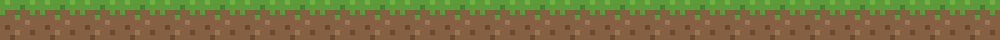

<!-- ⛏️ MINECRAFT-THEMED PROFILE • Kivssss -->

  

  

  
  

## 📜 Player Info

<table>
  <tr>
    <td width="65%">

**🧑 Name:** Kivsss 
**⭐ Level:** 23 
**🎓 Class:** Engineering Student 
**🗺️ Biome:** Learning & Building 
**🎯 Current Quest:** Grow myself while helping others 

> *"I give all to my work and tasks to deliver great, satisfying results. Always eager to learn new things, for myself and for others."*

</td>
    <td width="35%" align="center">
      
    </td>
  </tr>
</table>

## 🎒 Inventory

  

  
🔍 <b>Open Full Chest</b>

   
  

    
  

## 🏗️ My Builds

  

| 🧱 Build | 📖 Description | ⚒️ Crafted With |
|---|---|---|
| 🌊 **[Floodguard](https://github.com/Kivssss/Floodguard-app)** | Flood monitoring & alert app that helps communities stay safe and prepared. | HTML · CSS · JS |

## 🏆 Achievements

  
  

  

## 📡 Join My Server

  
  <!-- Paste your real links below:
  
  
  -->

<code>&lt;Kivsss&gt; Thanks for visiting! Don't forget to ⭐ and follow!</code>

